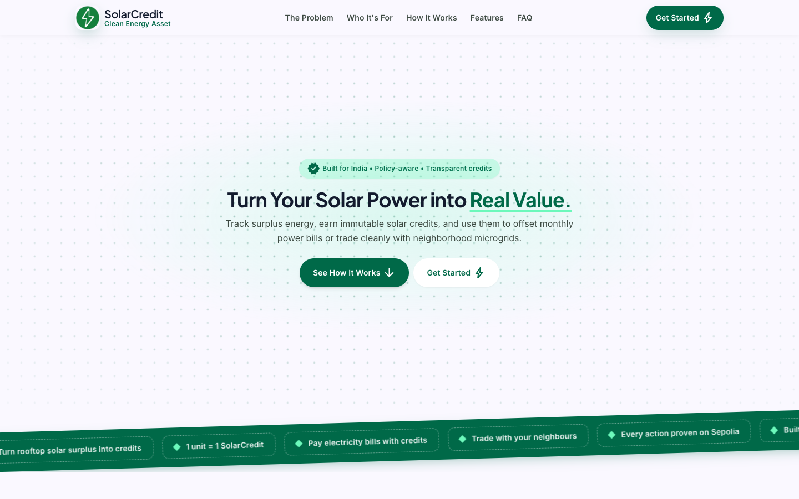
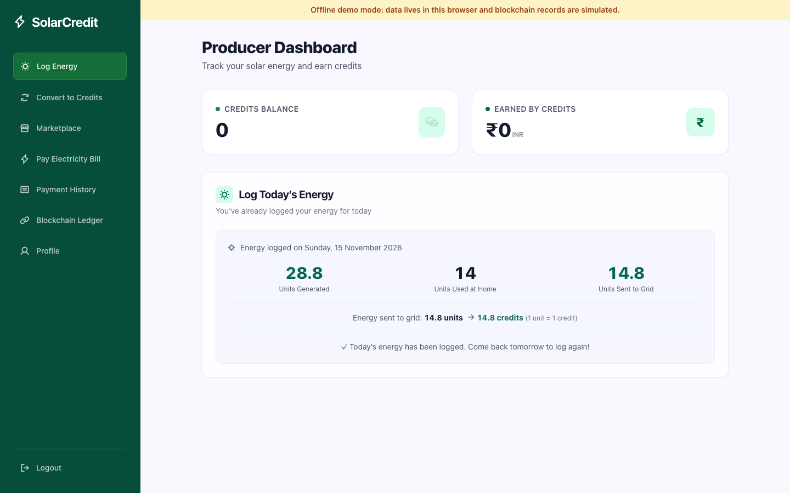
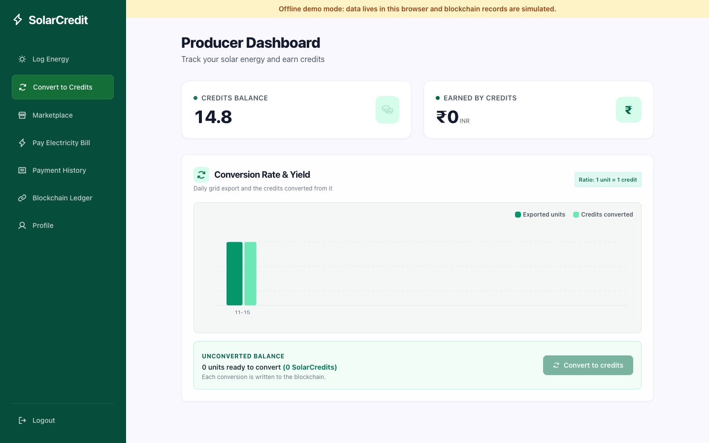
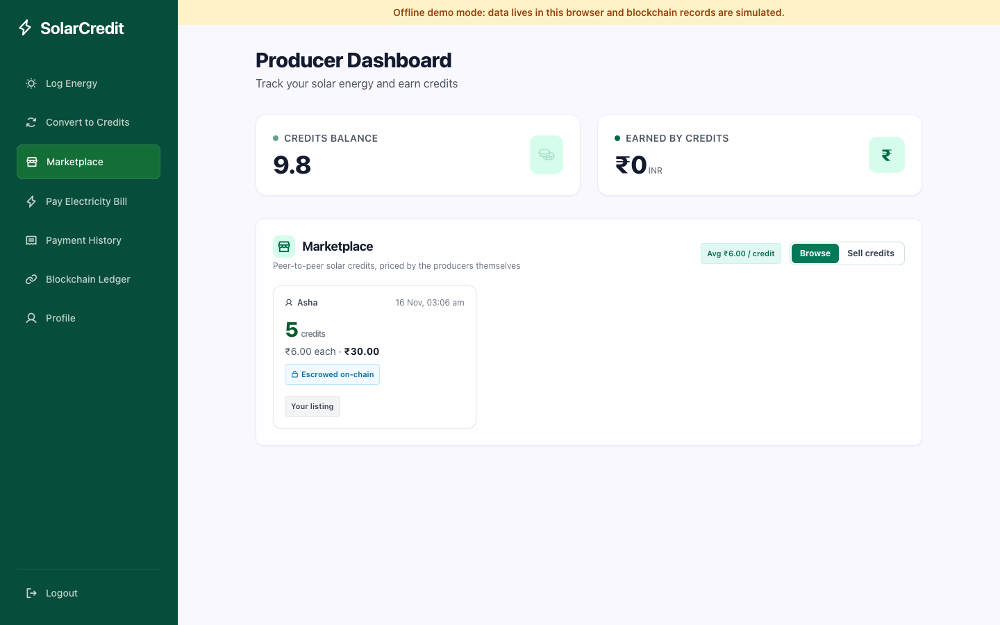
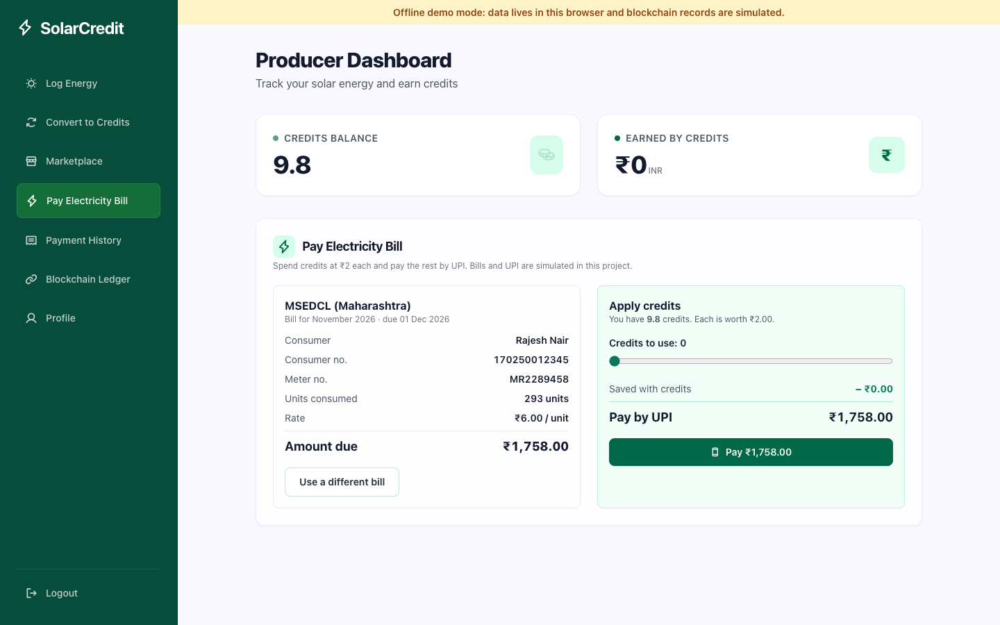
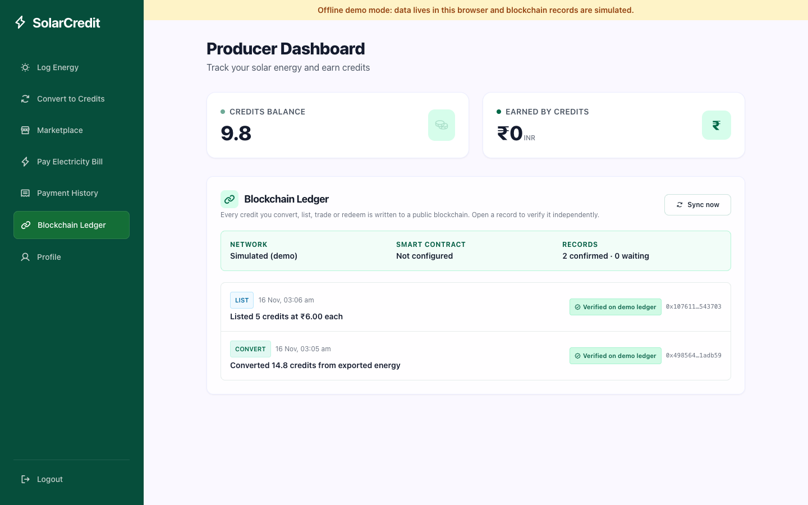
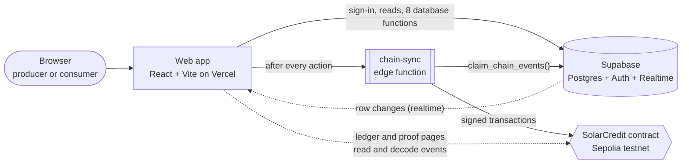
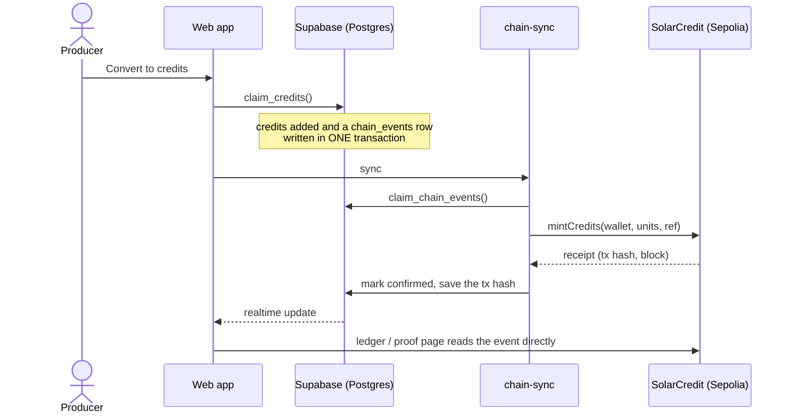

<p align="center">
  
</p>

<h1 align="center">SolarCredit</h1>

<p align="center">
  <b>Turn surplus rooftop solar into credits you can trade or use to pay your electricity bill,<br/>with every step recorded on a public blockchain.</b>
</p>

<p align="center">
  <a href="https://solar-credit-ofam.vercel.app"></a>
  <a href="https://github.com/Sai-dev313/Solar-Credit/actions/workflows/backend.yml"></a>
  <a href="https://github.com/Sai-dev313/Solar-Credit/actions/workflows/contracts.yml"></a>
  
</p>

<p align="center">
  
  
  
  
  
  
  
</p>

<p align="center">
  <a href="https://solar-credit-ofam.vercel.app"><b>Live site</b></a> ·
  <a href="#how-it-works">How it works</a> ·
  <a href="#try-it-in-two-minutes">Try it</a> ·
  <a href="#architecture">Architecture</a> ·
  <a href="#documentation">Docs</a> ·
  <a href="#the-team">Team</a>
</p>

<p align="center">
  
</p>

---

## Why SolarCredit

Millions of homes now produce more solar power than they use, but the surplus they send to the grid is
usually settled late, with paperwork, or not recognised at all. People who rent or live in apartments cannot
install panels and so cannot benefit.

**SolarCredit connects the two sides.** A producer's exported energy becomes a credit. Credits can be sold to
neighbours at a price the producer sets, or used to take money off an electricity bill. Every credit that is
created, listed, traded or spent is also written to a public blockchain, so anyone can check that the numbers are real.

## How it works

| | Step | What happens |
|:-:|---|---|
| **1** | **Log your energy** | A producer records the day's generation and home use. The surplus is what was sent to the grid. |
| **2** | **Convert to credits** | Surplus units become credits: **1 unit (1 kWh) = 1 credit**. |
| **3** | **Use or trade** | Sell credits on the marketplace (₹1 to ₹10 each), or spend them on an electricity bill: **1 credit = ₹2 off**. |
| **4** | **Verify on-chain** | Each action is recorded on the SolarCredit smart contract. The ledger and proof pages read the chain directly. |

## What it looks like

<table>
  <tr>
    <td width="50%"><br/><sub><b>Log energy</b>: today's reading and the credits it earns</sub></td>
    <td width="50%"><br/><sub><b>Convert to credits</b>: exported units and converted credits per day</sub></td>
  </tr>
  <tr>
    <td width="50%"><br/><sub><b>Marketplace</b>: peer-to-peer listings, credits held in escrow on-chain</sub></td>
    <td width="50%"><br/><sub><b>Pay a bill</b>: spend credits at ₹2 each, pay the rest by UPI</sub></td>
  </tr>
  <tr>
    <td colspan="2"><br/><sub><b>Blockchain ledger</b>: every conversion, listing, trade and bill, with its transaction hash</sub></td>
  </tr>
</table>

<sub>Screenshots are taken from the offline demo mode, so the data is sample data and the chain is simulated.</sub>

## Features

**For producers** (people with solar panels)
- Log daily generation and home use, with a simulated smart-meter feed
- Convert exported energy into credits, one click
- List credits at your own price; cancel any time and unsold credits come back
- Pay electricity bills with credits, or with simulated UPI for the rest

**For consumers** (renters and apartment dwellers)
- Buy clean credits from nearby producers
- Pay electricity bills with credits (provider-specific consumer-number checks for MSEDCL, Tata Power, BSES, BESCOM, TNEB, WBSEDCL, UPPCL and PSPCL)
- Full payment history

**For everyone**
- Email sign-up, and Sign in with Google (built in; switch it on by enabling the Google provider in Supabase). A Google user picks Producer or Consumer once, right after the first sign-in.
- **Blockchain ledger and proof pages** that read the public chain, not our database
- **Live updates**: when data changes in the backend the screen updates by itself
- **Offline demo mode**: the whole app runs in your browser with no backend and no accounts

## Architecture



**One action, end to end** (converting credits):



The database change is saved first, so the app keeps working even if the chain is slow or down; the event waits and is retried.
Details: [`docs/architecture/blockchain-flow.md`](docs/architecture/blockchain-flow.md).

## Tech stack

| Layer | Built with |
|---|---|
| **Frontend** (`web/`) | React 18, TypeScript, Vite 5, Tailwind CSS 3, React Router 6, ethers 6 |
| **Backend** (`supabase/`) | Supabase: Postgres with Row Level Security, PL/pgSQL functions, Auth, Realtime, Edge Functions (Deno) |
| **Blockchain** (`contracts/`) | Solidity 0.8.24, Hardhat 2, ethers 6, Sepolia testnet |
| **Offline demo** | [PGlite](https://pglite.dev), real Postgres compiled to run inside the browser |
| **Tests and CI** | Node + PGlite database tests, Hardhat and Chai contract tests, an end-to-end test, GitHub Actions |
| **Hosting** | Vercel (website), Supabase (backend) |

## Try it in two minutes

You need **Node.js 20 or newer**. No accounts, keys or backend are required for the demo.

```bash
git clone https://github.com/Sai-dev313/Solar-Credit.git
cd Solar-Credit/web
npm ci
VITE_DEMO=1 npm run dev        # Windows PowerShell:  $env:VITE_DEMO=1; npm run dev
```

Open the address Vite prints, choose **Get Started**, and sign up with any email and a password of 8+ characters.
Everything you do is stored in your browser only, and the blockchain records are simulated.

### Connect to a real backend

Copy [`web/.env.example`](web/.env.example) to `web/.env` and fill it in, then run `npm run dev` (without `VITE_DEMO`).

| Variable | Meaning |
|---|---|
| `VITE_SUPABASE_URL`, `VITE_SUPABASE_ANON_KEY` | Your Supabase project URL and its **publishable** key. Never put a secret or service key in `web/`. |
| `VITE_RPC_URL`, `VITE_CHAIN_NAME`, `VITE_EXPLORER_URL` | A public RPC endpoint and explorer for the chain |
| `VITE_CONTRACT_ADDRESS` | The deployed `SolarCredit` contract |

### Run the tests

```bash
# Backend: applies every migration to an in-memory Postgres and checks the rules and security (29 tests)
cd supabase && npm ci && npm run test:db

# Smart contract (8 tests)
cd contracts && npm ci && npm test

# End to end: database actions -> outbox -> chain-sync -> a real local chain
cd contracts && npx hardhat node                    # keep this running in a separate terminal
cd contracts && npm run deploy:local
cd supabase  && node tests/e2e.mjs
```

> `npm run deploy:local` rewrites `contracts/deployment.json` and the function's `abi.json`; restore them with `git checkout` before committing.

## Rules the system enforces

| Rule | Where |
|---|---|
| 1 unit of exported energy = 1 credit; 1 credit = ₹2 off an electricity bill | database functions |
| A listing's price must be **₹1 to ₹10** per credit | database + the form |
| Consumer numbers must match each provider's format (for example MSEDCL: 12 digits) | database + the form |
| Producer or Consumer is chosen **once**; a Google user chooses right after the first sign-in | database |
| Deleting a user removes their own data and keeps the other person's trade history | database |
| Credits and cash can only be changed by the database functions, never directly from the browser | Row Level Security and grants |

## Security model

- **The browser can read its own rows and cannot write any table.** Every change goes through one of **8 database functions** that take the user from `auth.uid()`, validate the input, and lock the rows they change.
- Row Level Security is on for every table; anonymous callers can call none of the functions.
- **Custodial blockchain model:** the platform owns the contract and signs every transaction, so users need no wallet and no gas. Each user still has their own on-chain address, and every event carries the id of its database row so the two can be audited against each other.
- Secrets (`CHAIN_PRIVATE_KEY`, the Supabase service key) live only in Supabase secrets, never in the repo or the website.

## Deploy

- **Website:** import the repo into Vercel, set the **Root Directory** to `web`, and add the environment variables above. [`web/vercel.json`](web/vercel.json) makes page refreshes work.
- **Backend:** apply the files in [`supabase/migrations/`](supabase/migrations/) **in order, once**. Turn **Confirm email off** in Supabase Authentication, and add your site address under URL Configuration.
- **Blockchain:** `npm run deploy:sepolia` in `contracts/`, then set the three `chain-sync` secrets and deploy the function. See [`docs/architecture/blockchain-flow.md`](docs/architecture/blockchain-flow.md).

The contract is live on Sepolia at
[`0x452eD9eAF8151E7eEF9746b6D7cFFF21a06A040b`](https://sepolia.etherscan.io/address/0x452eD9eAF8151E7eEF9746b6D7cFFF21a06A040b).

## Project structure

```text
.
├── web/                 React + TypeScript app (landing, auth, producer and consumer dashboards, proof pages)
│   └── src/data/        the one interface to the backend: Supabase implementation + offline demo
├── supabase/
│   ├── migrations/      tables, security, the 8 functions, triggers (apply in order)
│   ├── functions/       chain-sync edge function (sends events to the contract)
│   └── tests/           database tests and the end-to-end test
├── contracts/           SolarCredit.sol, Hardhat tests, deploy script, deployment record
├── docs/                API contract, data model, blockchain flow, screenshots
└── .github/workflows/   CI: backend tests and contract + end-to-end tests
```

## Documentation

| Document | What it covers |
|---|---|
| [`docs/api/API_CONTRACT.md`](docs/api/API_CONTRACT.md) | Exactly what the frontend expects from the backend and the blockchain |
| [`docs/database/DATA_MODEL.md`](docs/database/DATA_MODEL.md) | Tables, security, functions, triggers and the migration list |
| [`docs/architecture/blockchain-flow.md`](docs/architecture/blockchain-flow.md) | How an action reaches the chain, safety rules, secrets, deploy and test |

## Known limits

This is a student project, and it is honest about what is simulated:

- Electricity bills and UPI payments are **simulated**; no real money moves.
- The smart-meter feed is **simulated**; there is no real inverter or DISCOM integration yet.
- The blockchain is the **Sepolia testnet**, and wallets are custodial.
- An Etherscan verification script for the contract is not written yet.

## The team

<table>
  <tr>
    <td align="center" width="25%"><a href="https://github.com/srisainathm2000-eng"><br/><b>srisainathm2000-eng</b></a><br/>Frontend</td>
    <td align="center" width="25%"><a href="https://github.com/ganeshpamba"><br/><b>ganeshpamba</b></a><br/>Backend and database</td>
    <td align="center" width="25%"><a href="https://github.com/Shivakumar-09"><br/><b>Shivakumar-09</b></a><br/>Blockchain</td>
    <td align="center" width="25%"><a href="https://github.com/Sai-dev313"><br/><b>Sai-dev313</b></a><br/>Team lead, integration and deployment</td>
  </tr>
</table>

## Contributing

1. Branch from `main`, push, and open a pull request.
2. Wait for the checks to go green, then merge with **Create a merge commit** (not Squash) so everyone keeps credit for their commits.
3. Database changes are a **new** migration file with the next timestamp; never edit one that has already been applied.
4. Never commit `.env` files, private keys, or the Supabase secret key.
